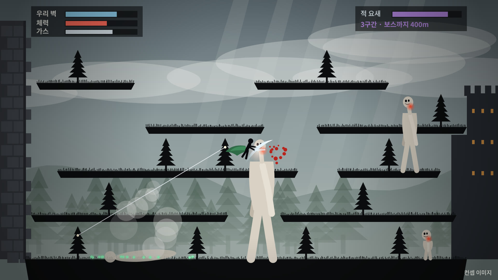
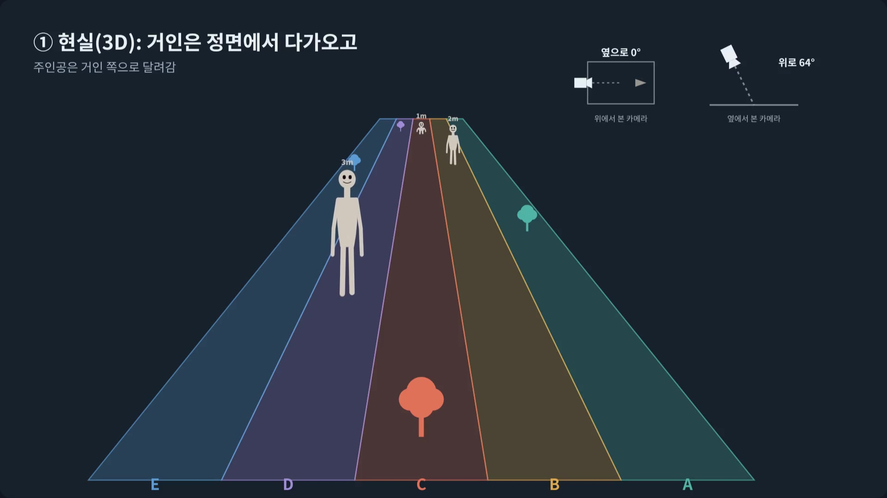
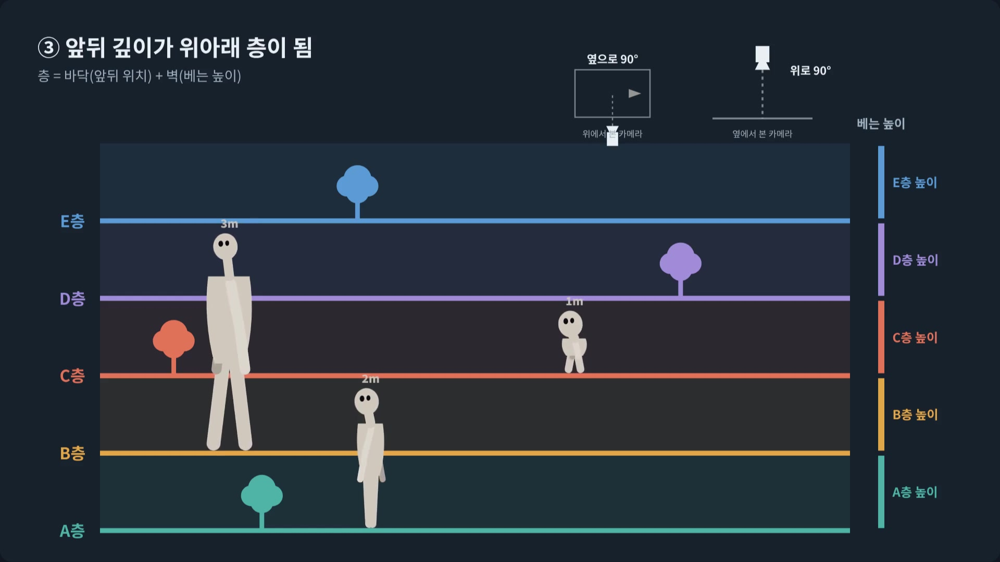
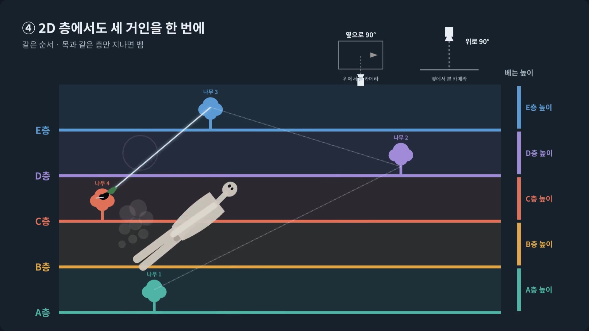
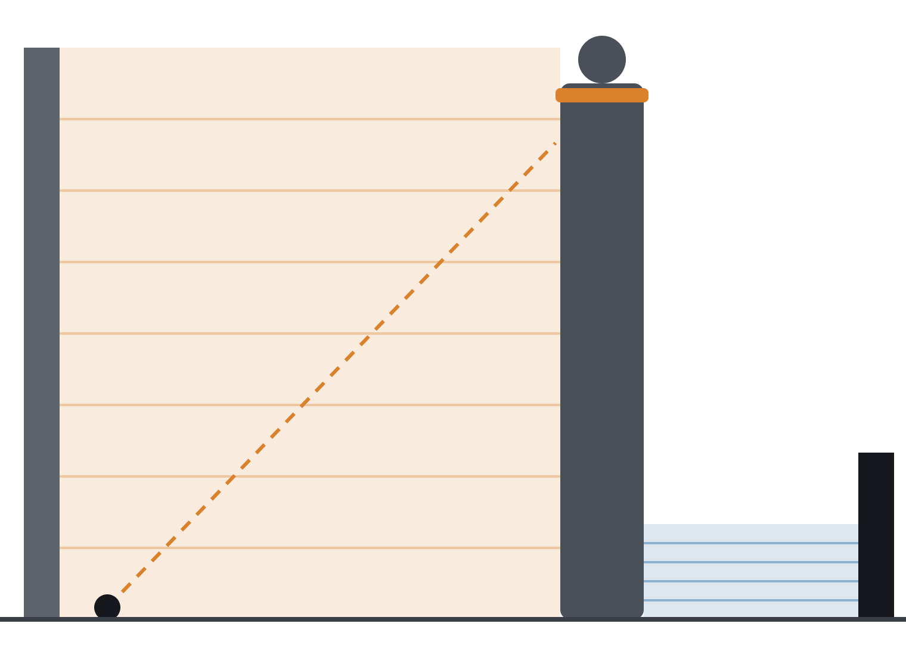

# PRD: Over the Wall (오버 더 월)

> 2D 게임 프로그래밍 · 2학기 프로젝트 · 한국공학대학교 이태린 2024314043
> 기준 문서: `OverTheWall_기획서.pptx`, `OverTheWall_1차발표.pptx` (2026-11-03)

## 1. 개요

와이어로 날아 구간마다 보스 거인을 쓰러뜨리고, 마지막에 적 요새를 무너뜨리는 **2D 횡스크롤 와이어 액션** 게임이다.

| 항목 | 내용 |
| --- | --- |
| 장르 | 횡스크롤 액션 + 강화 카드 선택 |
| 개발 환경 | Python, pico2d · 화면 1280×720 |
| 한 판 | 아군 벽을 나서 적 요새까지, 4개 구간 + 최종 구간 |
| 승리 | 구간마다 보스를 쓰러뜨리면 다음 구간으로 넘어간다. 최종 구간에서 적 요새 내구도가 0이 되면 승리 |
| 패배 | 플레이어가 죽거나, 아군 벽 내구도가 0이 되면 패배 |
| 모티브 | 『진격의 거인』 세계관 |
| 한 줄 소개 | 멈추지 않는 와이어 질주! 거인을 베며 적 요새까지 돌파한다 |



*컨셉 이미지: 와이어를 걸고 날아올라, 같은 층에 있는 거인의 부분을 벤다*

## 2. 기획 의도

### 2.1 문제: 와이어 액션을 3D로 만들면 조작이 복잡하다
와이어로 거인을 베려면 깊이와 높이를 둘 다 따져야 해서 보통 3D로 만든다. 하지만 3D에서는 360도 이동, 와이어, 공격을 한꺼번에 조작해야 해서 너무 복잡하다.

### 2.2 해결: 깊이를 층으로 접는다
길을 앞뒤 다섯 줄로 나누고 카메라를 옆으로, 위로 90° 돌리면 앞뒤 줄이 위아래 다섯 층이 된다. **층 하나가 거인이 서 있는 위치(바닥)이자 베는 높이(벽)** 가 된다.

| 단계 | 화면 |
| --- | --- |
| ① | 현실(3D): 거인은 정면에서 다가온다 |
| ② | 카메라를 옆으로 90° 돌린다 |
| ③ | 카메라를 위로 90° 돌린다. 앞뒤 깊이가 위아래 층이 된다 |
| ④ | 2D에서도 같은 층의 거인 여럿을 한 번에 벤다 |

| ① 현실(3D): 거인은 정면에서 다가온다 | ③ 앞뒤 깊이가 위아래 층이 된다 | ④ 2D 층에서도 세 거인을 한 번에 |
| --- | --- | --- |
|  |  |  |

층 = 바닥(앞뒤 위치) + 벽(베는 높이). 변환 과정 영상은 `OverTheWall_GitHub/docs/media/`에 있다.

### 2.3 차별성

| 구분 | 보통 게임 | Over the Wall | 효과 |
| --- | --- | --- | --- |
| 3D 액션을 2D로 | 와이어 액션은 3D로 만들고 360도 이동·와이어·공격을 한꺼번에 조작한다 | 앞뒤 깊이를 위아래 5층으로 접어 2D 횡스크롤로 옮긴다 | 3D보다 조작은 쉽고, 재미는 그대로 |
| 마우스만으로 이동 | 방향키 이동 또는 클릭 지점 이동. 클릭 이동은 계단식 지형에서 점프를 지원하지 않는 경우가 많다 | 달리기, 와이어, 층 사이 이동까지 모든 움직임을 마우스 하나로 한다 | 조작이 쉽고 행동이 빨라 공격에 집중할 수 있다 |
| 층은 땅이자 높이 | 계단식 구조의 층은 위아래 높이만 나눈다 | 층이 평면의 땅 역할도 해서 층에 상관없이 자유롭게 이동하고, 거인의 다리·몸통·목을 한눈에 구분한다 | 빠르게 움직이며 노릴 부위를 쉽고 전략적으로 고른다 |

## 3. 핵심 재미

1. **날아다니는 기동감**: 클릭한 높이에 와이어를 걸고 감아 올라 구조물 사이를 난다. 가스는 아껴 써야 한다.
2. **어디를 벨지 고르는 판단**: 목·몸통·발목 어디를 베어도 피해가 들어간다. 목덜미는 피해가 가장 크고, 발목은 거인을 무릎 꿇린다.
3. **묵직한 타격감**: 적을 베는 순간 히트스톱, 화면 흔들림, 큰 칼 궤적, 큰 피해 숫자. 증기를 뿜으며 쓰러지는 거인 모션으로 마무리한다.
4. **보스마다 다른 공략**: 구간마다 다른 보스가 각자 다르게 공격한다.
5. **빠른 속도감**: 다가오는 적보다 훨씬(5배 이상) 빠르게, 적 사이를 꿰뚫고 지나가는 질주감.

## 4. 플레이 흐름

| 순서 | 단계 | 내용 |
| --- | --- | --- |
| 1 | 이동하며 베기 | 와이어를 타고 날며 거인을 공격한다 |
| 2 | 카드 고르기 | 거인을 공격해 모은 경험치가 차면 카드 3장 중 1장을 고른다 (공격·기동·조력자·방어·필살기) |
| 3 | 점점 강해지기 | 공격력이 오르고 동료가 합류해 함께 싸운다. 무엇을 고르냐에 따라 판마다 다르게 강해진다 |
| 4 | 구간 돌파 | 구간 끝마다 보스가 있고, 뒤로 갈수록 어려워진다 |
| 5 | 요새 함락 | 쌓은 힘으로 최종 구간의 적 요새를 무너뜨리면 승리 |

### 4.1 화면 흐름

```
타이틀 ──클릭──▶ 플레이 ──경험치 가득──▶ 카드 선택 (플레이 위에 겹쳐 띄움, 월드 정지)
  ▲                 │  ◀──── 카드 고름 ────┘
  │                 ├──승리/패배──▶ 결과 화면 ──클릭──▶ 타이틀
  └──── ESC ────────┘
```

- 카드 선택 화면은 `push_mode` / `pop_mode`로 플레이 위에 띄우고, 고르는 동안 게임 월드는 멈춘다.
- 결과 화면에는 승패, 플레이 시간, 처치 수, 고른 카드 수를 보여 준다.

## 5. 조작

| 입력 | 동작 |
| --- | --- |
| 마우스 위치 | 그쪽으로 달리기 (멀수록 빠름). 달리기는 가스를 쓰지 않는다 |
| 왼쪽 클릭 | 클릭한 곳에서 가장 가까운 와이어 지점에, 클릭한 높이로 와이어를 건다 |
| Q | 베기 |
| W | 회오리 베기: 가까운 거인의 목 높이까지 솟아올라 벤다 (카드로 얻음) |
| E | 필살기: 거인화 (카드로 얻음) |
| 1 · 2 · 3, 클릭 | 강화 카드 선택 |
| ESC | 타이틀로 |

## 6. 핵심 시스템

### 6.1 5층 구조
- 길은 **5층**이다. 층 하나가 바닥(앞뒤 위치)이자 벽(베는 높이)이다.
- 거인의 다리(발목)·몸통·목이 각각 다른 층에 걸쳐 있다. 플레이어는 **자기가 있는 층에 걸친 부위**를 벤다.
- 거인 크기가 클수록 목이 더 높은 층에 온다. 크기별 목 높이 비율은 레벨 디자인에서 정한다.

### 6.2 와이어
- 나무·벽 같은 구조물의 와이어 지점을 클릭해 건다. 클릭한 높이로 걸리고, 감아 올리며 날아간다.
- 날아가는 중에도 다시 클릭하면 다음 지점으로 끊김 없이 이어 간다.
- 사거리 안에 있는 지점에만 걸 수 있다.
- 4구간에서는 초대형 거인의 몸에도 와이어를 걸 수 있다.

### 6.3 가스
- 와이어를 걸 때마다 가스를 쓴다.
- 땅에 내려와 있으면 가스가 다시 찬다.
- 그래서 플레이어는 언제 날고 언제 땅을 달릴지 스스로 고르게 된다.

### 6.4 공격
1. **구조물에 와이어를 건다**: 와이어가 꽂히고, 감아 올리며 날아간다.
2. **노리는 부위의 층에서 벤다**: 날아가며 베도 되고, 그 층을 달려와 베도 된다.
3. **한 번에 여러 적을 벤다**: 경로를 잘 짜면 구조물 → 적 → 적 → 구조물로 여럿을 한 번에 벤다.

| 부위 | 피해 | 효과 |
| --- | --- | --- |
| 목덜미 | 가장 큼 | 히트스톱, 화면 흔들림, 큰 궤적과 큰 피해 숫자 |
| 몸통 | 목덜미보다 작음 | 피해만 준다 |
| 발목 | 목덜미보다 작음 | 거인이 무릎을 꿇어 목이 내려온다. 갑옷 거인의 갑옷을 깬다 |

- 치명타와 연속 공격 시 화면 진동과 큰 칼 궤적을 보여 준다.
- 부위별 피해 배율, 치명타 확률은 레벨 디자인에서 정한다.

### 6.5 거인 공격 예고
- 거인 공격이 들어올 자리는 **빨간색으로 미리 칠한다.** 플레이어가 보고 피할 수 있어야 한다.

### 6.6 플레이어 상태 머신

| 상태 | 설명 | 나가는 조건 |
| --- | --- | --- |
| RUN | 땅에서 마우스 방향으로 달리기 (멈춤 포함) | 클릭 → WIRE, 발밑 길이 없음 → AIR, W → TORNADO |
| WIRE | 와이어를 감으며 날아가기 | 도착 → AIR, 다시 클릭 → WIRE |
| AIR | 공중에서 떨어지기 | 착지 → RUN, 클릭 → WIRE, W → TORNADO |
| TORNADO | 회오리 베기로 목 높이까지 솟아오름 | 끝나거나 대상 거인이 사라짐 → AIR |

- Q 베기는 어느 상태에서나 쓸 수 있다.
- E 거인화는 별도 상태로 다룰지 레벨 디자인 때 정한다.

### 6.7 초대형 거인 구간 (50층 규칙)



- 초대형 거인이 등장하면 **그 위치에서 우리 벽 쪽 전체가 50층**이 된다. 밀고 올수록 지나온 구간도 모두 50층이다.
- 초대형보다 오른쪽(요새 쪽)은 계속 5층이다. 초대형이 죽으면 모든 곳이 5층으로 돌아간다.

```
max_layer(x) = 50 if 초대형_생존 and x <= 초대형.x else 5
```

- 초대형의 목까지는 아주 높아서 올라가는 데 시간과 가스가 많이 든다.
- 와이어는 초대형의 몸과 구조물에 건다.

## 7. 구간과 보스

구간마다 보스를 쓰러뜨리면 다음 구간으로 넘어가고, 최종 구간에서 적 요새를 무너뜨리면 승리한다.

| 구간 | 보스 | 특징 | 공격 | 와이어 지점 |
| --- | --- | --- | --- | --- |
| 1 | 여성형 거인 | 가끔 빠르게 뛴다 | 줄을 원 모양으로 빙빙 돌려 공격 | 구조물 |
| 2 | 짐승 거인 | 아주 큰 몸집, 아주 작은 얼굴 | 멀리서 돌 투척 | 구조물 |
| 3 | 갑옷 거인 | 전신 장갑. 발목을 베어 갑옷을 깨야 목덜미가 들어간다 | 돌진 | 구조물 |
| 4 | 초대형 거인 | 거체, 목덜미가 50층 근처 | 변신 폭발, 고열 증기 | 구조물 + 초대형의 몸 |
| 최종 | 전퇴의 거인 | 최종 보스, 적 요새를 지킨다 | 땅에서 기둥을 솟게 해 공격. 마지막엔 요새 안에서 밖으로 | 구조물 |
| 추가 (선택) | 턱 거인 | 공격의 핵심, 강한 턱 | 가까이 붙으면 물기, 높은 공격력 | 구조물 |
| 추가 (선택) | 차력 거인 | 요리조리 잘 피하고 체력이 낮다 | 턱 거인의 체력 회복·공격력 증가 | 구조물 |

- 맵은 구간을 한 줄로 이어 붙인 형태다. 추가 구간을 넣으면 4구간과 최종 구간 사이에 끼운다.
- 각 구간에는 보스 외에 일반 거인이 나온다.

## 8. 캐릭터

### 8.1 플레이어
- 와이어와 가스로 날아다니며 벤다.
- 스프라이트: 64px 셀, 동작 8종
- 특수: 필살기 거인화 (카드로 얻음)
- 체력·공격력·속도는 레벨 디자인에서 정한다.

### 8.2 조력자
조력자는 **강화 카드로만** 들어오고 스스로 움직인다. 동료의 체력은 회복되지 않는다 (동료 치료 카드 제외).

| 이름 | 합류 시점 | 방식 |
| --- | --- | --- |
| 동료 1 | 1구간 보스 처치 후 | 전진하며 베기, 거인 최대 3명 |
| 동료 2 | 1구간 보스 처치 후 | 목덜미로 바로 날아가 벤다 |
| 동료 3 | 4구간 보스 처치 후 | 초대형 거인화 |

### 8.3 적 요새와 아군 벽
- **아군 벽**: 맵 왼쪽 끝. 거인이 닿으면 내구도가 깎이고, 0이 되면 패배.
- **적 요새**: 최종 구간 오른쪽 끝. 전퇴의 거인이 지키며, 내구도가 0이 되면 승리.

## 9. 강화 카드

### 9.1 카드 규칙
- 거인을 공격해 모은 경험치가 차면 카드 3장 중 1장을 고른다.
- 최대 횟수를 채웠거나 조건이 안 맞는 카드는 후보에서 빠진다.

### 9.2 카드 목록

| 분류 | 카드 | 효과 | 조건 |
| --- | --- | --- | --- |
| 공격 | 칼날 강화 | 공격력 ×1.4, 곱으로 쌓임 | 항상 |
| 공격 | 회오리 베기 (W) | 목 높이까지 솟아 벤다 | 항상 |
| 공격 | 회오리 연마 | 회오리 재사용 시간 ×0.7 | 회오리 베기를 가졌을 때 |
| 기동 | 가스 절약 | 가스 소모 ×0.75 | 항상 |
| 기동 | 가스통 확장 | 최대 가스 +35 | 항상 |
| 기동 | 와이어 강화 | 감는 속도 ×1.3, 사거리 +150 | 항상 |
| 조력자 | 동료 1 · 동료 2 | 동료 합류 | 1구간 보스 처치 후 |
| 조력자 | 동료 3 | 동료 합류 | 4구간 보스 처치 후 |
| 조력자 | 동료 치료 | 회복, 최대 체력 +2, 즉시 복귀 | 동료가 있을 때 |
| 방어 | 벽 보수 | 벽 내구도 +35 | 항상 |
| 방어 | 붕대 | 체력 모두 회복, 최대 체력 +1 | 항상 |
| 필살기 | 거인화 (E) | 거인화, 1회 | 레벨 디자인 때 정함 |

## 10. 화면 구성 (HUD)

1장의 컨셉 이미지 배치를 기준으로 한다.

| 위치 | 내용 |
| --- | --- |
| 왼쪽 위 | 우리 벽 내구도, 플레이어 체력, 가스 게이지 |
| 오른쪽 위 | 적 요새 내구도, 현재 구간과 보스까지 남은 거리 (예: `3구간 · 보스까지 400m`) |
| 아래 | 경험치 게이지, 스킬(W, E) 재사용 표시 |
| 보스 등장 시 | 보스 이름과 체력 바 |
| 구간 진입 시 | 구간 이름 표시 |
| 거인 공격 예고 | 공격이 들어올 자리를 빨간색으로 칠한다 |

## 11. 리소스

| 분류 | 목록 |
| --- | --- |
| 캐릭터 | 플레이어, 동료 1·2·3, 일반 거인, 필수 보스 5종 |
| 배경 | 구간별 배경, 와이어 지점 소품(나무, 벽 등) |
| 건물 | 아군 벽, 적 요새 |
| 사운드 | 배경 음악, 효과음 (와이어, 베기, 타격, 폭발) |
| UI | HUD, 카드, 타이틀, 결과 화면 그림 |

## 12. 개발 범위

### 12.1 반드시 완성
- 1구간 여성형 거인
- 2구간 짐승 거인
- 3구간 갑옷 거인
- 4구간 초대형 거인 (50층 규칙)
- 최종 구간 적 요새 · 전퇴의 거인
- 와이어 이동, 층 판정 전투, 카드 성장, 승패

### 12.2 시간이 남으면
- 추가 구간: 턱 거인 + 차력 거인
- 동료·카드 종류 늘리기, 구간별 음악

### 12.3 일정이 밀리면
- 배경 음악을 1~2곡으로 줄인다.
- 거인화(E)를 뒤로 미룬다.
- **5주차 점검 기간은 지킨다.**

## 13. 개발 일정

| 주차 | 기간 | 주제 | 세부 내용 |
| --- | --- | --- | --- |
| 1주 | 11/2~11/8 | 리소스 수집 | 캐릭터 스프라이트(플레이어, 동료 1·2·3, 일반 거인, 필수 보스 5종), 구간 배경과 와이어 지점 소품, 아군 벽·적 요새, 음악·효과음·UI 그림 |
| 2주 | 11/9~11/15 | 레벨 디자인 | 모든 캐릭터의 HP·공격력, 구간별 적 배치·크기 비율·지점 간격·보스 등장 시점, 카드 수치와 거인화 규칙 |
| 3주 | 11/16~11/22 | 1~3구간 구현 | 프레임워크·맵·카메라·5층 길, 달리기·와이어·가스·상태 머신, 일반 거인·층 판정 베기·타격감·카드·HUD, 보스 3종과 동료 1·2 |
| 4주 | 11/23~11/29 | 4구간 + 최종 구간 | 초대형 거인과 50층 규칙·동료 3, 전퇴의 거인과 적 요새, 승패·타이틀·결과 화면, 거인화(E), 사운드 |
| 5주 | 11/30~12/6 | 점검 | 버그 수정, 밸런스 조정, 퀄리티 보완 (새 기능 없음) |
| 6주 | 12/7~ | 발표 | 최종 점검, 시연, 발표 |

## 14. 개발 방식

### 14.1 프로토타입 먼저, PRD를 적용하며 바꾼다
1. **프로토타입(v0.1)**: 와이어 이동, 5층 베기, 거인, 카드, 벽·요새 승패까지 한 판이 돌아가는 최소 버전을 먼저 만든다. 그래픽은 임시 리소스를 쓴다.
2. **PRD 적용**: 프로토타입 위에 이 문서의 구간·보스·조력자·카드·50층 규칙을 하나씩 적용하며 바꾼다.
3. **리소스 교체**: 임시 리소스를 정식 리소스로 바꾼다.

### 14.2 커밋 규칙
- 기능 하나를 끝낼 때마다 커밋한다. 한 커밋에 기능 하나.
- 한글 한 줄 메시지로 쓴다 (예: `와이어 걸기와 감기 추가`).
- AI 코딩 도구를 활용하고, 발표 때 진행률을 커밋 기록으로 보여 준다.

## 15. 코드 구조

| 파일 | 역할 |
| --- | --- |
| `main.py` | 실행 진입점, 창 열기 |
| `game_framework.py` | 모드 전환 (`change_mode`, `push_mode`, `pop_mode`), 프레임 시간 |
| `game_world.py` | 레이어별 게임 오브젝트 관리, 충돌 처리 |
| `config.py` | 화면 크기, 층 간격, 구간 정의 등 상수 |
| `title_mode.py` / `play_mode.py` / `upgrade_mode.py` / `result_mode.py` | 화면별 모드 |
| `player.py` / `state_machine.py` | 플레이어와 상태 머신 |
| `giant.py` | 일반 거인과 보스 |
| `ally.py` | 조력자 |
| `wall.py` / `fortress.py` | 아군 벽, 적 요새 |
| `map_data.py` / `background.py` / `camera.py` | 구간, 와이어 지점, 배경, 카메라 |
| `upgrade.py` | 강화 카드 효과 |
| `ui.py` / `effect.py` / `render.py` | HUD, 이펙트, 그리기 도구 |

## 16. 위험 요소와 대응

| 위험 | 대응 |
| --- | --- |
| 일정 지연 | 12.3의 축소 순서를 따른다. 5주차 점검은 지킨다 |
| 초대형 50층 구간의 구현 난이도 | 카메라·층 계산을 `max_layer(x)` 한 곳에 모아 둔다 |
| 2D에서 층 판정이 직관적이지 않음 | 플레이어가 있는 층과 거인 부위를 화면에 강조해 보여 준다 |
| 원작 IP 사용 | 모티브 사용 범위를 교수님께 확인하고, 이름·외형은 바꿀 수 있게 데이터로 분리한다 |

## 17. 미정 사항

| 항목 | 정할 때 |
| --- | --- |
| 와이어 사거리, 감는 속도, 가스량과 소모량 | 레벨 디자인 |
| 플레이어·동료·거인의 체력, 공격력, 속도 | 레벨 디자인 |
| 부위별 피해 배율, 치명타 | 레벨 디자인 |
| 구간 길이, 와이어 지점 간격, 구간별 거인 크기 비율 | 레벨 디자인 |
| 구간별 배경, 분위기, 이야기 | 레벨 디자인 |
| 초대형 거인의 정확한 높이와 가스 소모량 | 레벨 디자인 |
| 경험치 요구량, 카드 수치와 최대 횟수, 거인화를 얻는 조건 | 레벨 디자인 |
| 동료의 재사용 시간, 체력, 공격력 | 레벨 디자인 |

## 18. 실행 방법

```bash
pip install pico2d
python main.py
```
