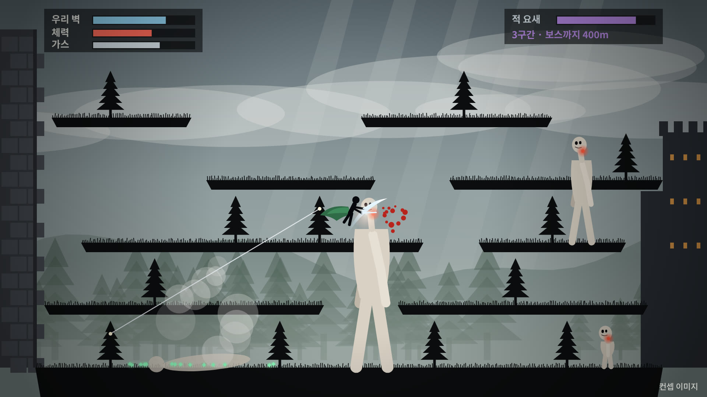

# 2DGP-OverTheWall
2D 게임 프로그래밍 텀프로젝트 - Over the Wall (Python, pico2d)

와이어로 날아 거인을 베고, 적 요새를 함락하는 2D 횡스크롤 와이어 액션 게임.



## 문서
- [PRD.md](PRD.md): 게임 기획 요구사항 (최종 목표)
- `OverTheWall_GitHub/docs/`: 기획서, 1차 발표 PPT, 층 구조 변환 영상

## 실행 방법
```bash
pip install pico2d
python main.py
```
리소스를 다시 만들려면 `pip install pillow` 후 `python tools/make_sprites.py`.

## 조작 (프로토타입 기준)
| 입력 | 동작 |
| --- | --- |
| 마우스 위치 | 그쪽으로 달리기 (멀수록 빠름) |
| 왼쪽 클릭 | 클릭한 높이·방향의 가장 가까운 와이어 지점에 와이어 걸기 (가스 소모) |
| Q | 베기 (서 있는 층에 따라 목덜미 / 몸통 / 발목) |
| W | 회오리 베기 (강화 카드로 얻음) |
| 1 · 2 · 3, 클릭 | 강화 카드 선택 |
| ESC | 타이틀로 |

## 현재 진행 상태 (중간 점검)
지금 코드는 **핵심 재미를 확인하기 위한 프로토타입(v0.1)** 이다. 프로토타입을 먼저 완성한 뒤, [PRD](PRD.md)를 하나씩 적용하며 바꿔 나간다.

| 항목 | 상태 |
| --- | --- |
| 6층 길, 와이어 이동, 가스 | ✅ 프로토타입 구현 |
| 층 판정 베기 (목덜미·몸통·발목), 타격감 | ✅ 프로토타입 구현 |
| 거인, 보스, 우리 벽, 적 요새, 승패 | ✅ 프로토타입 구현 |
| 동료, 대포, 강화 카드 | ✅ 프로토타입 구현 |
| 타이틀 → 플레이 → 카드 선택 → 결과 화면 | ✅ 프로토타입 구현 |
| 스프라이트 | 🔲 코드로 그린 임시 그래픽 (교체 예정) |
| 레벨 디자인 (구간, 수치) | 🔲 PRD 기준으로 확정 예정 |
| PRD의 구간 4개 + 최종, 보스 5종, 조력자 3명 | 🔲 적용 예정 |
| 초대형 거인 50층 규칙, 거인화(E), 사운드 | 🔲 적용 예정 |

## 커밋 규칙
- 기능 하나를 끝낼 때마다 커밋, 한 커밋에 기능 하나
- 한글 한 줄 메시지
- 프로토타입 단계의 커밋은 앞에 `[프로토타입]`을 붙인다
